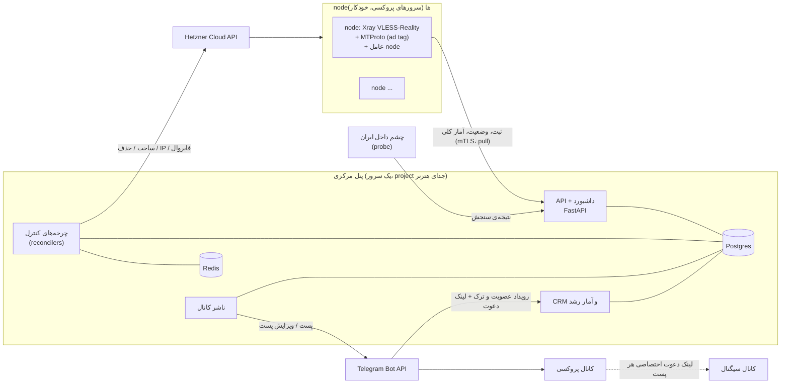

# ۱. معماری

## نمای کلی

## اصل اول: حالت مطلوب و چرخه‌ی کنترل
مالک **هدف** را تعیین میکند، نه کار را. هر بخش یک چرخه‌ی کنترل دارد که هر چند ثانیه:
1. حالت **مطلوب** را از دیتابیس میخواند. مثال: «۶ node سالم در دو منطقه، ۱۰ پست در روز، بودجه‌ی ماه ۸۰ یورو».
2. حالت **واقعی** را میسنجد: API هتزنر، گزارش عامل‌های node، سنجش‌های ایران، تلگرام.
3. **کوچک‌ترین** کار لازم برای نزدیک شدن به هدف را انجام میدهد و نتیجه را ثبت میکند.

این طراحی چند ویژگی دارد:
- **idempotent است:** اجرای دوباره چیزی را خراب نمیکند.
- **مقاوم است:** پنل اگر وسط کار بیفتد، بعد از بالا آمدن از همان‌جا ادامه میدهد.
- **ایمن است:** هر چرخه با قفل اجرا میشود (Postgres advisory lock یا Redis lock)، پس دو نسخه هم‌زمان دو node نمیسازند.

| چرخه | هدف | کارها |
|---|---|---|
| `fleet` | تعداد و پراکندگی nodeهای سالم | ساخت node، حذف node بیمار یا سوخته، رعایت سقف بودجه و تعداد |
| `node_health` | هر node یا سالم است یا در حال تعویض | خواندن heartbeat عامل؛ اگر heartbeat نیامد، اول restart سرویس و بعد reboot و بعد تعویض |
| `reachability` | میدانیم کدام IP از ایران باز است | جمع کردن سنجش‌ها و حکم «سوخته» |
| `configs` | همیشه به اندازه‌ی کافی کانفیگ تازه برای پست‌های بعدی آماده است | ساخت کانفیگ روی node سالم، با سقف زمان و حجم |
| `publisher` | برنامه‌ی پست امروز اجرا شده است | پست تازه، و ویرایش پست تمام‌شده |
| `post_status` | وضعیت هر پست با واقعیت کانفیگش یکی است | ⌛️ / 🔴 / 🚫 |
| `budget` | هزینه‌ی ماه از سقف نمیگذرد | پیش‌بینی خرج ماه؛ اگر نزدیک سقف شد، ساخت متوقف میشود و فقط تعویض انجام میشود |
| `self` | خود پنل سالم است | backup، فضای دیسک، گواهی‌ها، صف‌ها |

## اجزا
### پنل مرکزی (control plane)
- **API و داشبورد:** FastAPI. داشبورد بیشتر برای **دیدن** است: nodeها، کانفیگ‌ها، پست‌ها، رشد و هزینه. چیزهایی که مالک تعیین میکند:
  - هدف‌ها: تعداد node، پست در روز، سقف کانفیگ.
  - سقف بودجه.
  - متن تبلیغ و متن وضعیت‌ها.
  - کلید توقف کامل (kill switch).
- **worker:** چرخه‌های کنترل و کارهای زمان‌بندی‌شده.
- **Postgres:** منبع حقیقت.
- **Redis:** قفل، محدودیت نرخ (برای تلگرام و هتزنر) و cache.
- **ناشر کانال و گیرنده‌ی رویدادهای تلگرام:** webhook ربات.

### node
- **چه دارد:** یک سرور کوچک هتزنر با:
  - **Xray-core** (VLESS + Reality + Vision).
  - **پروکسی MTProto** با fake-TLS و **ad tag**، که کانال اسپانسر از آن میآید (`02_GROWTH.md`).
  - **عامل node** (برنامه‌ی کوچک).
- **کار عامل node:**
  - **مدل pull:** خودش از پنل میپرسد چه کانفیگ‌هایی باید فعال باشد. پنل به node فرمان مستقیم نمیدهد، پس پنل به SSH روی nodeها نیاز ندارد.
  - کاربران و سقف‌ها را از راه API داخلی Xray (gRPC: HandlerService و StatsService) اعمال میکند.
  - هر دقیقه آمار **کلی** میفرستد: مصرف هر کانفیگ، تعداد اتصال، CPU، RAM و شبکه.
  - **ارتباط با پنل:** با mTLS. گواهی را پنل هنگام ساخت node در cloud-init میگذارد و یک‌بارمصرف است.

### چشم داخل ایران (probe)
- **چیست:** یک عامل کوچک روی یک VPS ایرانی (تصمیم O5).
- **کارش:** هر چند دقیقه به هر node، TCP، TLS و یک اتصال واقعی VLESS و MTProto میزند و نتیجه را به پنل میفرستد.
- **وقتی نیست یا خودش قطع است:** از نشانه‌های ترافیک استفاده میشود (`03_NODES.md`).

## جریان یک روز
1. **`configs`:** میبیند برای ۱۰ پست امروز ۱۰ کانفیگ لازم است، و روی nodeهای سالمِ کم‌بار کانفیگ میسازد.
2. **`publisher`:** سر هر نوبت یک پست میگذارد: کانفیگ، QR، دکمه‌ی اتصال، تبلیغ پایین پست و لینک دعوت اختصاصی کانال سیگنال.
3. **عامل node:** مصرف را گزارش میکند. وقتی کانفیگی به سقف حجم رسید، **`post_status`** پستش را با 🔴 ویرایش میکند.
4. **`reachability`:** probe میگوید IP یک node از ایران بسته است.
   - **`fleet`** یک node تازه میسازد.
   - **`configs`** کانفیگ‌های بعدی را روی node تازه میسازد.
   - پست‌های node سوخته 🚫 میگیرند.
   - node سوخته، بعد از اینکه دیگر کانفیگ فعالی ندارد، حذف میشود.
5. **CRM:** هر عضویت تازه در کانال سیگنال را با لینک دعوتش به یک پست نسبت میدهد.
6. **`budget`:** خرج امروز را حساب میکند و «هزینه‌ی هر عضو» به‌روز میشود.
